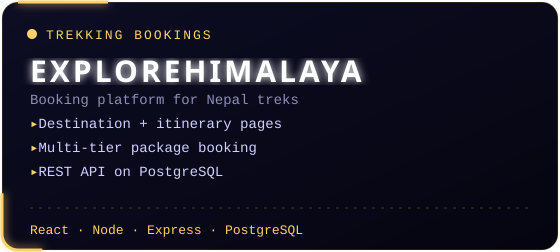
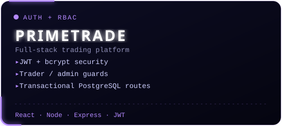
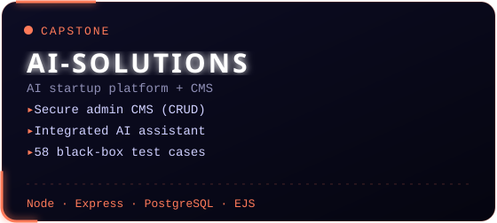
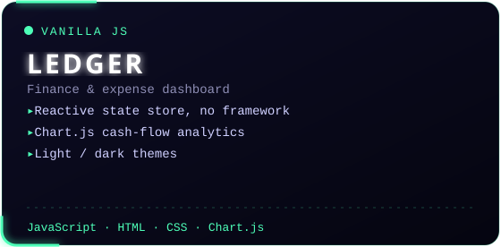

<p align="center">
  
</p>

<p align="center">
  <a href="https://readme-typing-svg.demolab.com"></a>
</p>

<p align="center">
  <a href="https://www.linkedin.com/in/surajshahcs"></a>
  <a href="https://github.com/surajshah20"></a>
  <a href="mailto:suraj27227@gmail.com"></a>
  <a href="https://portfolio-ebon-six-74.vercel.app/"></a>
</p>


<p align="center">
  <a href="https://getblushbook.com"></a>
  <a href="https://devguardai-gqng.onrender.com"></a>
  <a href="https://tender-mero.vercel.app/"></a>
  <a href="https://explorehimalaya.vercel.app"></a>
  <a href="https://github.com/surajshah20/primetrade-backend"></a>
  <a href="https://github.com/surajshah20/ai-solutions"></a>
  <a href="https://finance-dashboardui.netlify.app/"></a>
</p>


<p align="center">
  
</p>


```diff
+ [DONE] BlushBook live in production — 30+ physical photobook orders delivered
+ [DONE] DevGuard AI — AST + Gemini LLM security agent
+ [DONE] TenderMero — Firecrawl + Claude AI procurement platform
! [NOW]  Playwright E2E testing & CI/CD pipelines
! [NOW]  PostgreSQL tuning, indexing & connection pooling
- [NEXT] Land a Full-Stack / Frontend / QA Engineering role  ← you could be the commit
```


<p align="center">
  
  
</p>
<p align="center">
  
</p>
<p align="center">
  
</p>

<p align="center">
  
</p>


