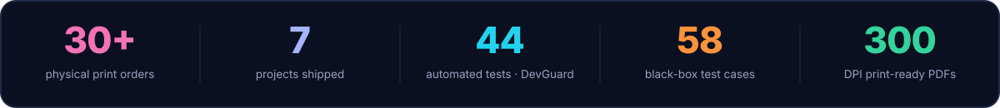
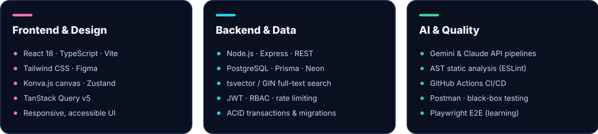
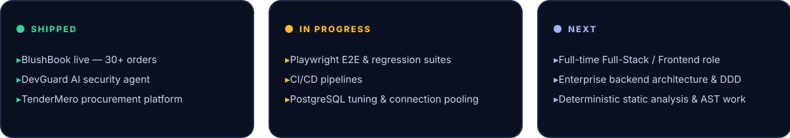

  

  
  
  
  

  

 

**BSc (Hons) Computer Systems Engineering** graduate from **ISMT College** (affiliated with the **University of Sunderland, UK**), available for full-time junior software engineering roles.

I architect and ship production React, Node.js and PostgreSQL platforms. I'm the creator of **BlushBook** (a commercial web-to-print SaaS with 30+ physical print orders fulfilled across Nepal), **DevGuard AI** (an autonomous AST + LLM security code-review agent) and **TenderMero** (a procurement intelligence and tender aggregation platform).

My foundations: deterministic static analysis (ESLint API / AST), asynchronous AI ingestion pipelines, complex client-side canvas state (Konva.js / Zustand), high-DPI client-side print pipelines (jsPDF at 300 DPI), and relational database indexing (PostgreSQL tsvector / GIN).

 

 

  

  

  

  
  
  
  

Click any project to open it · Expand below for full case studies

<b>🛡️ DevGuard AI — Autonomous Code Review & Security Analysis Agent</b>

A full-stack security review agent combining deterministic AST static analysis with Google Gemini LLMs to detect vulnerabilities, explain root causes, and propose automated git patch fixes.

- **Hybrid Analysis Engine:** deterministic AST static analysis + Google Gemini LLMs to uncover vulnerabilities, evaluate root causes, and suggest actionable remediation.
- **In-Memory GitHub Inspection:** repository scanner over the GitHub REST API bounding file size/counts, redacting credentials (PATs, AWS keys, secret tokens), and mitigating prompt injection through strict isolation.
- **OWASP & Static Rules:** custom detector covering OWASP Top 10 and CWEs (command injection, SQLi, eval, path traversal, weak crypto) plus an in-memory ESLint engine with zero disk writes.
- **Automated Patch Delivery:** generates unified git diff patches (`.patch`) applied instantly via `git apply`.
- **CI & Automated Tests:** dark-theme dashboard with severity distribution bars, filtering and markdown reports, backed by **44 automated tests** and a GitHub Actions CI workflow.

**Stack:** Node.js · Express · React · Vite · Google Gemini API · ESLint API · Zod · Octokit
👉 [Live Demo](https://devguardai-gqng.onrender.com)

<b>📚 BlushBook — Commercial Web-to-Print Photobook SaaS</b>

A live production web-to-print platform enabling customers across Nepal to design, customize, and order physical photobooks, fulfilling **30+ custom print orders**.

- **Canvas Architecture:** interactive HTML5 Konva.js canvas engine with real-time element transformations, photo pan/zoom cropping geometry, and dynamic snap-alignment guides.
- **300 DPI Print Pipeline:** in-browser PDF compilation with **jsPDF** producing 300 DPI production-ready PDFs with automated bleed margins and dynamic spine-width calculations.
- **State & Draft Recovery:** **Zustand** state management with multi-step undo/redo history snapshots and automated draft recovery to prevent data loss in long design sessions.
- **Cold-Start Elimination:** template loading cut from **~15s to near-instant** by resolving PostgreSQL cold starts through in-memory route caching and pre-bundled static snapshots.
- **Backend & RBAC:** REST APIs with role-based access control (Admin/User), PostgreSQL data management, and Cloudinary media pipelines.

**Stack:** React · Node.js · Express · PostgreSQL · Konva.js · Zustand · Cloudinary · jsPDF
👉 [getblushbook.com](https://getblushbook.com)

<b>🏛️ TenderMero — Centralized Procurement & Tender Intelligence Platform</b>

An institutional-grade tender aggregation platform for Nepal, collecting, standardizing, and indexing public procurement notices from PPMO and e-GP portals into a searchable full-stack marketplace.

- **AI Ingestion Pipeline:** asynchronous crawler using Firecrawl and Claude AI schema extraction, transforming heterogeneous public notices into typed JSON records with automated deadline tracking.
- **PostgreSQL GIN Full-Text Search:** database-level search via `tsvector` and GIN indexing with automated triggers, plus SHA-256 cryptographic deduplication and exponential backoff retry safeguards.
- **Transactional Integrity:** relational PostgreSQL schema on Neon with `node-pg-migrate` migrations and ACID transaction rollbacks for multi-record ingestion.
- **Server-State Caching:** React 18 dashboard with **TanStack Query v5** for intelligent caching, background revalidation, instant sector filtering, and personal watchlist tracking.
- **Production Security:** hybrid authentication (JWT + rotating `httpOnly` refresh cookies with cross-site `SameSite=None`), rate limiting, and role-based access control (Admin/Bidder).

**Stack:** React 18 · Node.js · Express · PostgreSQL · TanStack Query · Firecrawl · Claude AI · Neon · Vite
👉 [Live Demo](https://tender-mero.vercel.app/) · [GitHub](https://github.com/surajshah20/TenderMero)

<b>🏔️ ExploreHimalaya — Trekking Booking Platform</b>

End-to-end trekking booking application with destination pages, interactive booking workflows, and payment integration for multi-tier packages.

- **Booking Workflows:** destination browsing, itinerary selection, and multi-tier package reservation workflows.
- **REST Architecture:** RESTful endpoints handling package details, user inquiries, and booking transactions backed by PostgreSQL.

**Stack:** React · Node.js · Express · PostgreSQL · REST APIs
👉 [Live Demo](https://explorehimalaya.vercel.app) · [GitHub](https://github.com/surajshah20/explorehimalaya)

<b>💹 PrimeTrade — Full-Stack Trading Platform</b>

Trading platform backend and React dashboard with JWT authentication, role-based access control, and protected PostgreSQL-backed routes.

- **Authentication & RBAC:** secure token signing, bcrypt password encryption, and middleware guards safeguarding trader and admin operations.
- **Transactional Reliability:** protected RESTful endpoints backed by PostgreSQL with transactional integrity.

**Stack:** React · Node.js · Express · PostgreSQL · JWT
👉 [GitHub](https://github.com/surajshah20/primetrade-backend)

<b>🤖 AI-Solutions — AI Startup Platform & CMS (Capstone)</b>

Full-stack academic capstone project featuring a custom content management system, bcrypt-secured admin dashboard, and an integrated AI assistant.

- **Admin CMS:** secure CMS with full CRUD capabilities, bcrypt password encryption, and session authentication.
- **Rigorous Verification:** validated reliability and edge-case resilience through **58 documented black-box test cases**.

**Stack:** Node.js · Express · PostgreSQL · EJS · bcrypt
👉 [GitHub](https://github.com/surajshah20/ai-solutions)

<b>💰 Ledger — Finance & Expense Analytics Dashboard</b>

A responsive personal finance dashboard featuring balance analytics, transaction CRUD, simulated role-based access, and light/dark themes.

- **Reactive State Engine:** lightweight reactive state store in vanilla JS with localStorage, keeping UI and data in sync without a third-party framework.
- **Data Visualization:** Chart.js to visualize cash-flow dynamics, spending distribution, and real-time balance trends.

**Stack:** Vanilla JavaScript (ES6+) · HTML5 · CSS3 · Chart.js
👉 [Live Demo](https://finance-dashboardui.netlify.app/) · [GitHub](https://github.com/surajshah20/finance-dashboard)

 

 

 

  

 

 

 

  
  

  

 

  

